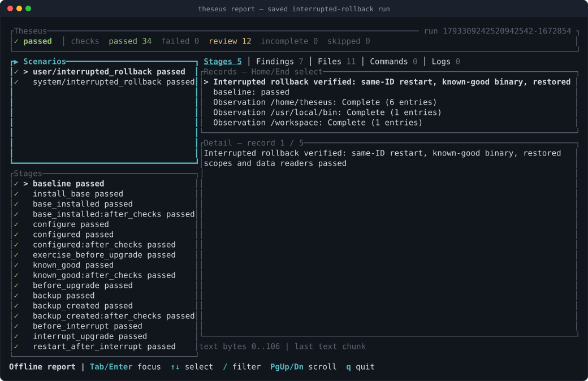
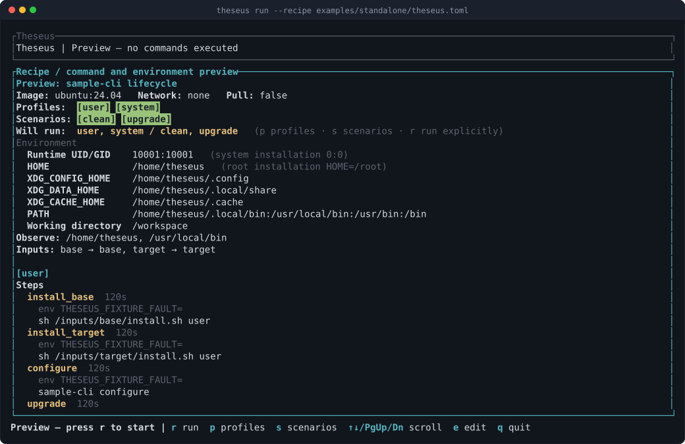

<div align="center">

# Theseus

**Know what your tool leaves behind.**

[](https://github.com/AraneaDev/theseus/actions/workflows/ci.yml)
[](https://www.rust-lang.org/)
[](LICENSE)

</div>

> Ariadne gave Theseus a thread to find his way back through the Labyrinth.
> Theseus follows a tool through its installation lifecycle and records the
> evidence needed to retrace what changed.

Theseus rehearses CLI installation, configuration, upgrade, reinstall,
interrupted installation/upgrade, forward recovery, declared downgrade compatibility
or rejection, rollback after a declared failed or deliberately interrupted upgrade,
runtime checks, local Claude Code plugin lifecycles and uninstall in disposable Linux containers.
A Ratatui workbench and headless CLI use one scenario engine. Evidence includes commands, private logs, file fingerprints,
declared check outcomes, and remaining files that need review.

The same engine is available to an MCP client through `theseus serve`.
It runs locally over ordinary stdin/stdout pipes, without a model dependency
or a listening network service.



## What you can do

- **Rehearse a lifecycle:** select declared user/system profiles and scenarios,
  with a fresh owned container for each matrix entry.
- **Inspect before running:** preview the commands and public environment in
  the workbench; edit a validated copy and press `r` explicitly to execute it.
- **Check what changed:** inspect file fingerprints, metadata, command outcomes,
  runtime checks, retained data and findings that need review.
- **Exercise recovery:** declare interruption barriers, downgrade expectations
  and rollback prerequisites, with evidence for each permitted transition.
- **Compare approaches:** run installation methods or actual image IDs through
  the same engine and compare the declared observed scopes.
- **Use CLI, TUI or MCP:** start headlessly, browse saved evidence offline, or
  use six MCP tools to inspect recipes and manage an admitted run.
- **Rehearse local integrations:** test explicit Claude Code plugin inputs and
  version-bound MCP client registration inside disposable Linux guests.

Every claim is scoped to the checks and observations the recipe declares.
Review findings are visible alongside the outcome; a passing run can still
contain files that require a maintainer's judgment.

## Install from source

Use a current stable Rust toolchain and install from a checkout:

```sh
git clone https://github.com/AraneaDev/theseus.git
cd theseus
cargo install --path . --locked
theseus --help
```

Docker CLI and a reachable Docker daemon are required for execution and cleanup.
Validation and saved report viewing work offline. Docker access is configured by
you; Theseus does not change daemon settings or user groups. Recipes are intended
for maintainer-controlled inputs. A container is not a hostile-code sandbox.

Theseus 0.12 targets native Linux, macOS and Windows controllers, with Linux
containers as guests. See [installation and controller scope](docs/get-started/installation.md)
for architectures, filesystem qualification and prerequisites.

**Release acceptance requires the same source** to pass all three native host
jobs and all eight Linux Docker suites. Native gates include ordinary Rust and
Python pipes, Windows `CreatePipe`, and the actual MCP server; a successful build
or one launcher does not qualify the others. Consult the
[source-specific CI results](https://github.com/AraneaDev/theseus/actions/workflows/ci.yml)
and [validation scope](docs/contribute/validation.md).

## Try a complete example

From the repository root, pull the guest image and enter the standalone example:

```sh
docker pull ubuntu:24.04
cd examples/standalone
theseus validate
theseus                       # preview first; press r explicitly to run
theseus run --headless         # all four user/system × clean/upgrade entries
theseus run --headless --profile user --scenario clean
```

The fixture installs real v1/v2 shell executables, configures them, checks their
identity and retained data, and removes the declared executable paths.
The image must already be available unless you explicitly request `run --pull`.
Theseus resolves and records the immutable image ID used by the run.

The workbench lets you select a profile and scenario before execution, then
browse stages, findings, commands and logs. Saved evidence can be reopened
without Docker. From the example's recipe project, replace `RUN_ID` with the
location printed by the run:



```sh
theseus report .theseus-runs/RUN_ID
theseus report .theseus-runs/RUN_ID --json
theseus cleanup .theseus-runs/RUN_ID
```

`report --json` returns 0 when the saved report is read successfully; inspect
its saved outcome separately. Cleanup verifies journaled resource identities
and ownership labels. There is no global Docker prune.

Follow [your first run](docs/get-started/first-run.md) for the walkthrough and
starter recipe, or open the [examples index](docs/README.md#examples) for
reinstall, interruption, downgrade, rollback and comparison fixtures.

## Use Theseus from an MCP client

Create canonical directories and launch the server with explicit native roots:

```sh
theseus serve --project-root /absolute/project --output-root /absolute/evidence --max-run-seconds 3600
```

On Windows, use native paths such as `C:\work\project` and `C:\work\evidence`.
Tool recipe paths are portable relative `/` paths beneath the project root.
Inspection and evidence reads do not prepare Docker or execute a recipe.

| Tool | Purpose |
| --- | --- |
| `recipe_inspect` | Inspect a recipe and page sanitized records. |
| `run_start` | Admit a digest-bound selection. |
| `run_list` | List this server process's admissions. |
| `run_status` | Poll cached state or refresh saved evidence. |
| `run_cancel` | Request cancellation of an admitted run. |
| `run_evidence` | Page saved records and raw log bytes. |

Admission is distinct from run success. Follow the returned polling advice and
inspect the finished engine outcome. The [MCP server guide](docs/agents/mcp-server.md)
contains both protocol-era transcripts, roots, bounds, paging, idempotency and
shutdown contracts. [MCP lifecycle checks](docs/guides/mcp-lifecycle.md) instead
rehearse another server's registration inside a Linux guest.

## Documentation

The [documentation index](docs/README.md) groups the complete contracts by task.

| I want to… | Read |
| --- | --- |
| Install and run my first recipe | [Installation](docs/get-started/installation.md), [first run](docs/get-started/first-run.md) |
| Use the terminal workbench | [Preview, editor and evidence controls](docs/guides/workbench.md) |
| Write a lifecycle recipe | [Schemas, scenarios and checks](docs/reference/recipes.md) |
| Compare installation approaches | [Comparison suites](docs/guides/comparisons.md) |
| Understand a saved result | [Evidence, outcomes and limits](docs/reference/evidence.md) |
| Recover owned resources | [Recovery and cleanup](docs/operate/recovery.md) |
| Rehearse a plugin or MCP registration | [Plugins](docs/guides/plugins.md), [MCP lifecycles](docs/guides/mcp-lifecycle.md) |
| Run the local acceptance gates | [Validation and scope](docs/contribute/validation.md) |

Technical limits stay beside the contract they constrain: capture truncation,
bounded comparisons, explicit recovery, typed client claims and incomplete
cleanup are described in their respective guides.

## Scope and future work

The controller matrix does not establish native macOS/Windows guest adapters,
VMs, services, desktop applications or arbitrary installer safety. Recipes
declare observed expectations; application authors own quiescence, database
consistency and application-specific restoration.

See [ROADMAP.md](ROADMAP.md) for completed milestones, current progress and remaining work, and the
[validation guide](docs/contribute/validation.md) for required versus opt-in
acceptance. Existing example walkthroughs remain next to their fixtures.

## License

[MIT](LICENSE).
